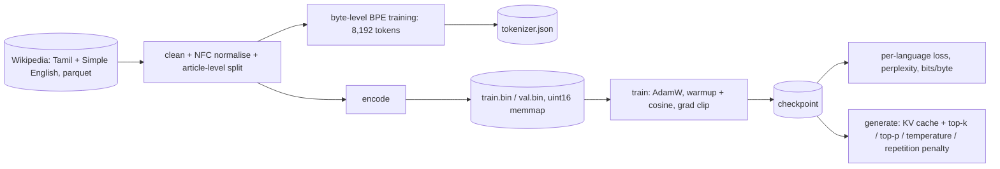

# tinygpt: a GPT trained from scratch on Tamil + English

**A decoder-only transformer, its byte-level BPE tokenizer, KV cache and samplers, written from scratch in PyTorch and trained on Tamil and Simple English Wikipedia on a laptop CPU.**


[](https://github.com/Alkarim786/gpt-from-scratch/actions/workflows/ci.yml)
[](LICENSE)

---

## Why
Most "build a GPT" projects use an English-only character tokenizer and stop at training. This one covers the parts that matter for real language models:
- a **multilingual byte-level BPE** that handles Tamil script correctly;
- a **KV cache** that's proven equivalent to full recomputation and measurably faster;
- proper **sampling** (temperature, top-k, top-p, repetition penalty);
- evaluation in **bits per byte**, the metric that is fair across tokenizers and languages.

No Hugging Face `transformers` or `tokenizers` are used. Every component is in this repo and tested.

## Architecture


**Model:** 4 pre-LayerNorm transformer blocks, d_model 256, 4 heads, context 256, GELU MLP (4×), learned positional embeddings, and weight tying between the embedding and output layer. GPT-2 init, with residual projections scaled by 1/√(2·n_layer). **5.32M parameters.**

## Key engineering decisions
- **Tamil-aware pre-tokenizer.** GPT-2's regex splits on `\p{L}+`. Tamil vowel signs and the virama (புள்ளி) are Unicode *combining marks* (`\p{M}`), so GPT-2's pattern breaks almost every Tamil syllable apart. The pattern here is `[\p{L}\p{M}]+`; the test `தமிழ் மொழி → ["தமிழ்", " மொழி"]` guards it. Text is NFC-normalised, so one syllable always has one byte sequence.
- **Fast BPE training.** Incremental pair counts and a lazy max-heap mean each merge only revisits the words that contain the merged pair. 7,935 merges over 20 MB of text took about 2 minutes in pure Python.
- **Attention written out explicitly** (scores → causal mask → softmax → weighted sum) rather than a fused kernel, so the KV-cache masking is visible. With a cache, query *i* sits at absolute position `past + i` and may attend to keys `0..past+i`.
- **KV cache with a sliding window.** Once the context fills up, the cache re-prefills with the most recent half-window. Tests check that cached and uncached decoding give the **same logits at every position** and **identical greedy outputs**.
- **Bits per byte** = total nats / ln 2 / UTF-8 bytes covered. Per-token perplexity depends on the tokenizer; BPB doesn't, so the English and Tamil numbers are comparable.
- **Bug caught by tests:** `F.cross_entropy(logits.view(...), targets.view(-1))` fails when targets are a non-contiguous slice like `x[:, 1:]`. It now uses `.reshape`.

## Results
All numbers were **measured on 2026-10-19 and 2026-10-28** on an **AMD Ryzen 5 7520U (4 cores / 8 threads), 16 GB RAM, Windows 11, CPU only (4 PyTorch threads)**.

### Data and tokenizer
| | Tamil | Simple English |
|---|---|---|
| Source | Wikipedia `20231101.ta` (first parquet shard) | Wikipedia `20231101.simple` (first shard) |
| Text used | 10 MB | 10 MB |
| Articles (train / val) | 1,818 / 95 | 6,844 / 360 |
| **Characters per token** | **3.28** | **3.25** |
| UTF-8 bytes per token | 8.52 | 3.26 |

Train: 4,036,508 tokens; validation: 199,851 tokens. Tamil chars/token is on par with English, so the tokenizer gives both languages a fair share of the 8,192-token vocabulary. (Tamil uses 3 bytes per character in UTF-8, hence its high bytes/token.)

### Training (1,000 steps × 16 × 256 tokens = 4.1M tokens, about one epoch)
| Step | Train loss | Val loss | Val perplexity |
|---|---|---|---|
| 0 | 9.047 | 9.045 | 8,474 |
| 100 | 6.122 | 6.413 | 610 |
| 300 | 5.315 | 5.679 | 293 |
| 500 | 4.904 | 5.328 | 206 |
| 700 | 4.798 | 5.170 | 176 |
| 1000 | **4.690** | **5.035** | **153.7** |

About 1,000 tokens/s training throughput on 4 CPU threads, roughly 69 minutes of compute in total. The run was paused at step 700 and resumed with `--resume`. That checkpoint predates optimizer-state saving, so AdamW's moments restarted at step 700; checkpoints now include optimizer state.

### Held-out evaluation (`python -m tinygpt.evaluate`)
| Language | Val loss | Perplexity | **Bits per byte** |
|---|---|---|---|
| English | 4.897 | 133.9 | 2.18 |
| Tamil | 5.224 | 185.8 | **0.88** |

Tamil's BPB is much lower, for two reasons. Each Tamil character is 3 UTF-8 bytes, so a correct character prediction "covers" more bytes. And Tamil Wikipedia has many templated village and census articles, which are highly predictable.

### KV cache (200 new tokens, greedy, 4 threads)
| | Time | Tokens/s |
|---|---|---|
| No cache (recompute the full context every step) | 10.30 s | 19.4 |
| **KV cache** | **3.68 s** | **54.4** |
| Speed-up | **2.8×** | identical greedy output: ✅ |

The speed-up grows with context length: without a cache each step costs O(T), so generation is O(T²) overall.

### Samples (temperature 0.8, top-k 50, top-p 0.95, seed 7)
- **Tamil**, prompt "தமிழ்நாடு": *"தமிழ்நாடு ஊரக வளர்ச்சி, மொத்தம் 7 ஊராட்சி மன்ற உறுப்பினர்களைத் தேர்ந்தெடுக்கின்றனர்…"* Fluent, grammatical Tamil, but it reproduces the census-village article template (with made-up numbers).
- **English**, prompt "The river": *"The river was the game for "PE) called…"*. Mostly noise at this scale. Simple English Wikipedia is far less templated, and 5M parameters with ~2M English tokens is very small.

These are honest outputs of a 5M-parameter model trained for about an hour on a CPU. The point is the working pipeline and measurable learning, not text quality.

## Roadmap / scaling up on a GPU
- Bigger config (e.g. 12 layers, d_model 768, context 1024, about 85M parameters) on the full Wikipedia dumps plus Tamil news; mixed precision (`torch.autocast`), `torch.compile`, and gradient accumulation.
- RoPE instead of learned positions; FlashAttention via `F.scaled_dot_product_attention` (kept explicit here for clarity).
- A tokenizer comparison against tiktoken / SentencePiece in bits per byte.

## Quick start
```bash
python -m venv .venv && . .venv/bin/activate            # Windows: .venv\Scripts\activate
pip install torch --index-url https://download.pytorch.org/whl/cpu
pip install -e ".[dev]"
python scripts/download_data.py                         # ~300 MB (two parquet shards)
python scripts/prepare.py --mb-per-lang 10 --vocab 8192
python -m tinygpt.train --steps 1000 --batch 16 --block 256 --eval-every 100 --threads 4
python -m tinygpt.evaluate
```
Or everything in one container: `docker compose up --build` (data, model and results go to mounted volumes).

## Usage
```python
from tinygpt.bpe import BPETokenizer
from tinygpt.evaluate import load
from tinygpt.generate import SamplingConfig, generate

tok = BPETokenizer.load("data/prepared/tokenizer.json")
model = load("runs/base/ckpt.pt")
ids = generate(model, tok.encode("தமிழ்"), SamplingConfig(max_new_tokens=80, temperature=0.8, top_k=50, top_p=0.95))
print(tok.decode(ids))
```

## Testing
```bash
pytest     # 18 tests
```
- **Tokenizer:** the Tamil pre-tokenizer keeps marks attached; exact round-trip for Tamil, emoji, accents and whitespace; deterministic training; special token; save/load.
- **Model:** shapes and near-uniform initial loss; **causality** (changing future tokens never changes past logits); **KV cache equals the full forward pass at every position**; cached and uncached greedy generation are identical; sliding window past the context limit; context-length enforcement; overfits a tiny batch; weight decay only on matrices; tied weights.
- **Sampling and training:** top-k/top-p nucleus maths, repetition penalty, seeded reproducibility; token stream targets shifted by one; LR warmup and cosine schedule.

CI runs lint and the tests on every push (tiny models, no dataset download).

## Project structure
```
tinygpt/
  bpe.py        byte-level BPE (Tamil-aware pre-tokenizer, heap-based training, cached encode)
  model.py      GPT, attention with KV cache, MLP, blocks, optimizer groups
  generate.py   sampling (greedy, temperature, top-k, top-p, repetition penalty), cached decoding
  data.py       Wikipedia parquet -> cleaned text -> tokenizer + uint16 memmaps
  train.py      training loop (warmup + cosine, clipping, eval, checkpoints, --resume)
  evaluate.py   per-language loss / perplexity / bits-per-byte, KV-cache benchmark, samples
scripts/        download_data.py, prepare.py
runs/base/      train_log.json, train_log_steps_0_700.txt, eval.json (checkpoint is git-ignored)
```

## License
[MIT](LICENSE) © Karim (Alkarim786). Data: Wikipedia, CC BY-SA 4.0.
